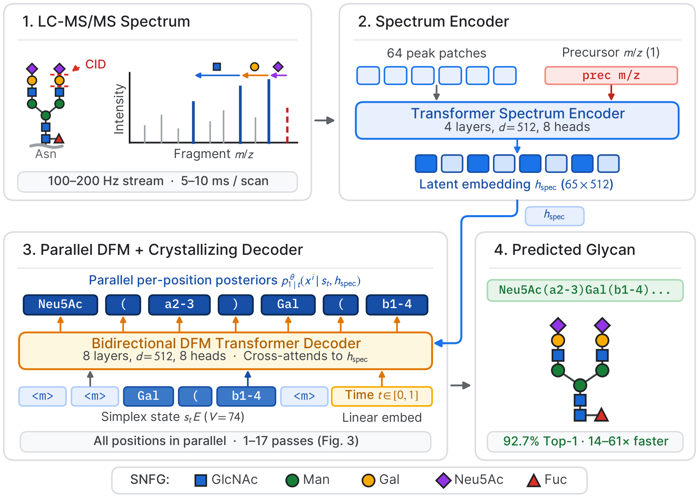

# GlycoGen

Code and evaluation suite for **"GlycoGen: Glycan Structure Prediction with Crystallizing Flows"** (NeurIPS 2026 · [Project Page](https://romainlacombe.com/glycogen/) · [Dataset & Benchmark](https://huggingface.co/datasets/rlacombe/candycrunch-v2-benchmark)).

<p align="center">
  
</p>

GlycoGen is a 50M-parameter encoder-decoder model that predicts full IUPAC-condensed glycan structures directly from tandem mass spectra (MS/MS). It pairs a dual-channel spectrum patch encoder and a 74-token atomic IUPAC vocabulary with **Crystallizing Flows**, a deterministic sampler that propagates full per-position token distributions on the probability simplex, locks each position once its argmax leaves `<mask>`, and exits early per spectrum once all positions commit.

Two GlycoGen variants ship in this repository. Both share the same spectrum patch encoder, 74-token IUPAC vocabulary (`70` monosaccharide, linkage, and branch-bracket tokens plus `4` special tokens), CandyCrunch v2 benchmark split, and Crystallizing Flows sampler, differing only in their training objective:

- **GlycoGen-DFM (50M)** — trained with Discrete Flow Matching ([Gat et al., 2024](https://arxiv.org/abs/2407.15595)).
- **GlycoGen-MDLM (50M)** — trained with Masked Diffusion Language Modeling on a 128-step grid ([Sahoo et al., 2024](https://arxiv.org/abs/2406.07524)).

We also provide two matched baselines trained on the exact same split:
- **GlycoGen-AR (46.4M)** — architecture-matched causal autoregressive Transformer decoder trained with teacher-forced cross-entropy.
- **GlycoBART reproduction (207M)** — full-scale reproduction of [Abtheen et al. (2025)](https://doi.org/10.1101/2025.07.02.662857) retrained from scratch on the leak-free CandyCrunch v2 benchmark split.

## Headline results on the CandyCrunch v2 benchmark

All models are trained from scratch across three random seeds (`0, 1, 2`) on a single 141 GB H200 GPU in BF16 and evaluated per spectrum on the held-out test split (`76,774` spectra from `434` disjoint LC-MS runs) via exact `glycowork` graph isomorphism (`glycowork.motif.graph.compare_glycans`), without multi-scan voting or database snap-back:

| Model | Params | Inference setting | Top-1 accuracy (3 seeds) | Mean NFE | Batched latency (H200 BF16) | Speedup vs. greedy GlycoBART |
|---|---:|---|---:|---:|---:|---:|
| **GlycoGen-DFM + Crystallizing Flows** | 50M | `K = 1` (one-shot argmax) | `90.19% ± 0.04%` | `1.0` | `0.046 ms/spec` (`21,883 spec/s`) | `61×` |
| **GlycoGen-DFM + Crystallizing Flows** | 50M | `K = 8` (recommended) | **`92.51% ± 0.06%`** | `5.0` | `0.201 ms/spec` (`4,975 spec/s`) | `13.9×` |
| **GlycoGen-DFM + Crystallizing Flows** | 50M | `K = 32` | **`92.67% ± 0.05%`** | `17.4` | `0.675 ms/spec` (`1,481 spec/s`) | `4.1×` |
| **GlycoGen-DFM + Crystallizing Flows** | 50M | `K = 64` | **`92.69% ± 0.06%`** | `33.9` | `1.306 ms/spec` (`766 spec/s`) | `2.1×` |
| **GlycoGen-MDLM + Crystallizing Flows** | 50M | `K = 1` | `89.73% ± 0.17%` | `1.0` | `0.046 ms/spec` | `61×` |
| **GlycoGen-MDLM + Crystallizing Flows** | 50M | `K = 8` | `92.30% ± 0.12%` | `5.0` | `0.199 ms/spec` | `14.1×` |
| **GlycoGen-MDLM + Crystallizing Flows** | 50M | `K = 32` | `92.47% ± 0.11%` | `17.4` | `0.676 ms/spec` | `4.1×` |
| **GlycoGen-AR** | 46.4M | `beam = 1` (greedy) | `90.38% ± 0.05%` | `33.0` | `2.21 ms/spec` | `1.3×` |
| **GlycoGen-AR** | 46.4M | `beam = 32` (seed 0) | `90.39%` | `1,045` | `72.66 ms/spec` | `0.04×` |
| **GlycoBART reproduction** | 207M | `beam = 1` (greedy) | `80.92% ± 0.31%` | `23.0` | `2.80 ms/spec` | `1.0×` |
| **GlycoBART reproduction** | 207M | `beam = 32` (seed 0) | `78.57%` (`86.35%` top-5) | `720` | `91.21 ms/spec` | `0.03×` |

In unbatched single-spectrum serial streaming (raw `peak_d` dictionary to decoded IUPAC string), `K = 1` runs in `8.6 ± 0.3 ms/spec` (`116 Hz`, matching `100 Hz` / `10 ms` live LC-MS/MS scan cadence) and `K = 8` runs in `33.8 ± 2.5 ms/spec`.

## Repository layout

```text
glycogen/
├── dfm/                              GlycoGen-DFM (50M)
│   ├── train.py                      Train from scratch + Pareto sweep on CandyCrunch v2
│   ├── eval.py                       CLI wrapper for eval-only and subset evaluations
│   ├── test_eval.py                  Unit tests for eval.py helpers and sampler aliases
│   └── README.md
└── mdlm/                             GlycoGen-MDLM (50M)
    ├── train.py                      128-step grid MDLM training + Crystallizing Flows / Euler sweeps
    └── README.md

baselines/
├── ar_seq2seq/                       GlycoGen-AR baseline (46.4M, matched encoder/decoder shape)
│   ├── train.py                      Causal Transformer decoder + beam-search Pareto sweep
│   ├── beam_compare_hf.py            A/B check against HuggingFace-style beam scorer
│   ├── beam_diversity.py             Beam diversity and graph-equivalence diagnostics
│   ├── pareto_high_beams.py          High-beam (16, 32) sweep with H200-safe batch caps
│   └── README.md
└── glycobart/                        GlycoBART reproduction (207M, Abtheen et al., 2025)
    ├── train_glycobart.py            From-scratch training on the CandyCrunch v2 benchmark
    ├── eval_glycobart.py             Per-spectrum beam sweep on the held-out test split
    ├── eval_cabsel_full_pipeline.py  CABSEL post-processing evaluation (with database snap-back)
    ├── eval_with_postprocessing.py   Mass / class / fragment reranking without database snap-back
    ├── eval_top5_at_beam.py          Top-5 candidate-pool evaluation
    ├── eval_top5_per_beam.py         Per-beam nucleus-padded top-5 evaluation
    ├── post_process.py               Mass-check and CandyCrumbs fragment-scoring utilities
    ├── BASELINE_PROTOCOL.md          Split construction and baseline methodology protocol
    └── README.md

data_utils/                           Deterministic CandyCrunch v2 benchmark split builders
├── make_benchmark_split.py           Build LC-MS file-grouped split, row_manifest.csv, CABSEL sentences
├── make_aligned_numerical_pkls.py    Build 2048-bin dual-channel numerical pickles aligned to manifest
├── make_numerical.py                 Optional cross-check builder importing candycrunch.prediction
└── README.md

hf_dataset_card/
└── README.md                         Hugging Face Dataset Card for rlacombe/candycrunch-v2-benchmark
```

## Preprocessed benchmark and checkpoints (Hugging Face)

Preprocessed benchmark splits and trained checkpoints are hosted on Hugging Face:

- **CandyCrunch v2 Benchmark (`378,880 / 42,097 / 76,774`):** [`rlacombe/candycrunch-v2-benchmark`](https://huggingface.co/datasets/rlacombe/candycrunch-v2-benchmark)
- **GlycoGen-DFM (50M):** [`rlacombe/glycogen-dfm-50m`](https://huggingface.co/rlacombe/glycogen-dfm-50m) (seeds 1 & 2 at `-seed1`, `-seed2`)
- **GlycoGen-MDLM (50M):** [`rlacombe/glycogen-mdlm-50m`](https://huggingface.co/rlacombe/glycogen-mdlm-50m) (seeds 1 & 2 at `-seed1`, `-seed2`)
- **GlycoGen-AR (46.4M):** [`rlacombe/glycogen-ar-50m`](https://huggingface.co/rlacombe/glycogen-ar-50m) (seeds 1 & 2 at `-seed1`, `-seed2`)
- **GlycoBART reproduction (207M):** [`rlacombe/glycobart-207m-repro`](https://huggingface.co/rlacombe/glycobart-207m-repro) (seeds 1 & 2 at `-seed1`, `-seed2`)

Every training and evaluation script downloads from these repositories automatically by default and honors `HF_DATASET_REPO`, `HF_REPO`, and `HF_OUTPUT_REPO` environment variable overrides.

## Rebuilding the CandyCrunch v2 benchmark from raw Zenodo data

The benchmark split (`378,880` train / `42,097` val / `76,774` test = `497,751` usable spectra from `503,446` raw rows) can also be rebuilt deterministically on CPU from the upstream CandyCrunch v2 Zenodo archive ([`10.5281/zenodo.15741423`](https://doi.org/10.5281/zenodo.15741423), CC BY 4.0):

```bash
# Step 1 — LC-MS file-grouped split (GroupShuffleSplit, test_size=0.15, seed=42)
# Emits data/row_manifest.csv, data/sentences_benchmark.pkl, data/vocab_glycobart.txt
python data_utils/make_benchmark_split.py \
    --dataset  ./data/raw/dataset.parquet \
    --antennae ./data/raw/glycans_antennae.csv \
    --out_dir  ./data

# Step 2 — 2,048-bin dual-channel numerical pickles aligned to row_manifest.csv
# Emits data/X_{train,val,test}.pkl and data/y_{train,val,test}.pkl
python data_utils/make_aligned_numerical_pkls.py
```

Partitioning by LC-MS source `filename` ensures zero shared runs between `{train, val}` (`2,455` files) and `test` (`434` files), preventing chromatographic-peak leakage across co-eluting scans, charge states, adducts, and separated anomers. See [`data_utils/README.md`](data_utils/README.md) and [`hf_dataset_card/README.md`](hf_dataset_card/README.md) for schema details.

## Training from scratch

Each headline model trains on a single H200 (141 GB) GPU in BF16. Pass `INIT_SEED=0`, `1`, or `2` to reproduce the 3-seed runs:

| Model | Wall-clock (1× H200) | Command |
|---|---|---|
| GlycoGen-DFM (50M) | ~40 min | `cd glycogen/dfm && INIT_SEED=0 python train.py` |
| GlycoGen-MDLM (50M) | ~40 min | `cd glycogen/mdlm && INIT_SEED=0 python train.py` |
| GlycoGen-AR (46.4M) | ~40 min | `cd baselines/ar_seq2seq && INIT_SEED=0 python train.py` |
| GlycoBART reproduction (207M) | ~9 h | `cd baselines/glycobart && BATCH_SIZE=160 LR=1.414e-5 EPOCHS=30 EARLY_STOP_PATIENCE=999 INIT_SEED=0 python train_glycobart.py` |

## Evaluation sweeps (checkpoint inference without retraining)

```bash
# GlycoGen-DFM: full Crystallizing Flows Pareto sweep over K in {1,2,4,8,16,32,64}
cd glycogen/dfm
python eval.py --subset all --k pareto --sampler crystallizing_flows --output dfm_cf_pareto.json

# GlycoGen-DFM: standard CTMC Euler baseline sweep
python eval.py --subset all --k pareto --sampler ctmc_euler --output dfm_euler_pareto.json

# GlycoGen-DFM: unseen-string generalization subset (~571 test spectra)
python eval.py --subset unseen --k pareto --sampler crystallizing_flows --output dfm_unseen.json

# GlycoGen-MDLM: Crystallizing Flows (grid-snapped or continuous t) and CTMC Euler
cd ../mdlm
PARETO_ONLY=1 SAMPLER=crystallizing_flows MDLM_GRID_SNAP=1 python train.py
PARETO_ONLY=1 SAMPLER=crystallizing_flows MDLM_GRID_SNAP=0 python train.py
PARETO_ONLY=1 SAMPLER=ctmc_euler python train.py

# GlycoGen-AR: beam-search sweep over beam in {1,2,4,8,16,32}
cd ../../baselines/ar_seq2seq
PARETO_ONLY=1 python train.py

# GlycoBART reproduction: per-spectrum beam sweep on the held-out test set
cd ../glycobart
python eval_glycobart.py
```

## Environment and tests

- Python 3.10+, PyTorch ≥ 2.4 with BF16 CUDA support (`pip install -r requirements.txt`).
- Each training script also includes a PEP 723 inline-dependency header for single-file `uv run` / Hugging Face Jobs execution.
- Run the unit test suite for `glycogen/dfm/eval.py`:
  ```bash
  python -m pytest glycogen/dfm/test_eval.py -v
  ```

## License

Code in this repository is released under the MIT License (see [`LICENSE`](LICENSE)). The CandyCrunch v2 benchmark data is derived from [Urban et al. (2024)](https://doi.org/10.1038/s41592-024-02314-6) ([Zenodo `10.5281/zenodo.15741423`](https://doi.org/10.5281/zenodo.15741423)) under [CC BY 4.0](https://creativecommons.org/licenses/by/4.0/).

## Citation

```bibtex
@inproceedings{lacombe2026glycogen,
  title     = {GlycoGen: Glycan Structure Prediction with Crystallizing Flows},
  author    = {Lacombe, Romain},
  booktitle = {Advances in Neural Information Processing Systems (NeurIPS)},
  year      = {2026}
}
```
